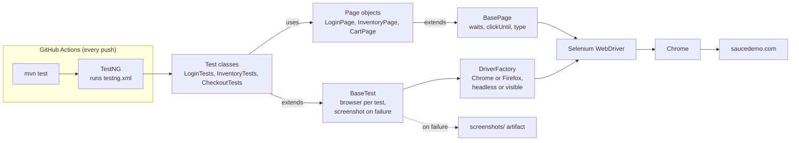

# Selenium + TestNG Test Framework

[](https://github.com/kayla-damoah/selenium-testng-framework/actions/workflows/ci.yml)

UI test automation in Java 17 with Selenium 4, TestNG and Maven, run in GitHub Actions on every push.

Target: [Sauce Demo](https://www.saucedemo.com), a public practice shop.

New to the project? Start with [docs/HOW_IT_WORKS.md](docs/HOW_IT_WORKS.md), a plain-English walkthrough.

## How it fits together



## What it demonstrates

- **Page Object Model**: selectors and page behavior live in `pages/`, tests only describe intent.
- **Explicit waits only**: `BasePage` wraps `WebDriverWait`; there is no `Thread.sleep`.
- **Parallel-ready**: a `ThreadLocal<WebDriver>` gives each test its own browser. CI runs one at a time (`thread-count=1` in `testng.xml`) because parallel browsers on a small runner caused dropped clicks; raise it where there's more CPU.
- **Actions verify their own result**: `clickUntil` and `type` in `BasePage` check that a click or keystroke took effect and retry, because the demo site occasionally drops them (see `docs/HOW_IT_WORKS.md`, section 8).
- **Data-driven tests**: TestNG `@DataProvider` for invalid-login cases.
- **Screenshot on failure**, uploaded as a CI artifact.
- **Config via system properties**: `-Dbrowser=chrome|firefox`, `-Dheadless=true|false`.

## Run it

Needs JDK 17+, Maven, and Chrome (Selenium Manager downloads the driver itself).

```bash
mvn test                              # headless Chrome, full suite
mvn test -Dheadless=false             # watch it run
mvn test -Dbrowser=firefox            # supported in DriverFactory but not yet run in CI
mvn test -Dgroups=smoke               # smoke subset only
```

Reports: `target/surefire-reports/`. Failure screenshots: `screenshots/`.

## Layout

```
src/test/java/com/kayla/qa/
  base/    DriverFactory, BaseTest (setup, teardown, screenshots)
  pages/   BasePage, LoginPage, InventoryPage, CartPage
  tests/   LoginTests, InventoryTests, CheckoutTests
testng.xml
```

## Ideas to extend

- Allure or ExtentReports HTML reporting
- Selenium Grid / Docker for cross-browser runs
- A retry analyzer with flaky-test reporting
- API setup of test state to speed up UI tests
